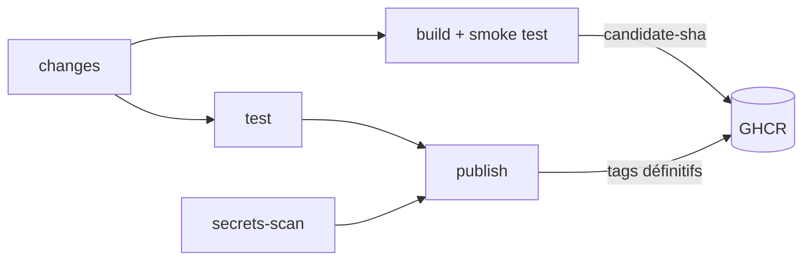

# Pipeline CI/CD avec Docker — P8

Deux applications, testées puis publiées en images Docker sur GHCR par un pipeline GitHub Actions unique.

| Dossier | Application | Techno |
|---|---|---|
| `olympic-games-starter/` | Olympic Participation Tracker (front) | Angular 20 + Nginx |
| `workshop-organizer/` | Workshop Organizer (API) | Spring Boot 3 / Java 21 + PostgreSQL 13 |

Autres fichiers : `.github/workflows/ci.yml` (pipeline), `run-tests.sh` (tests), `ops/` (sauvegarde / restauration),
`plan-de-tests.pdf`, `dossier-exploitation.pdf`.

## Prérequis

- Docker et Docker Compose
- Pour les tests en local : Node 22 + Chrome (front), JDK 21 (back), bash (Git Bash sous Windows)

## Pipeline (`.github/workflows/ci.yml`)

Déclenchement : push (toutes branches), pull request vers `main`, lancement manuel.

| Contexte | Applications traitées |
|---|---|
| push sur `main` | toujours les deux |
| push sur une autre branche, pull request | seulement les applications modifiées |
| lancement manuel | au choix : une application ou les deux |



| Job | Rôle |
|---|---|
| `changes` | détecte les applications modifiées et leur type (node / java) → matrice |
| `test` | `run-tests.sh <app>`, rapport JUnit dans l'onglet *Checks* |
| `secrets-scan` | Gitleaks sur tout l'historique |
| `build` | build de l'image, smoke test, puis push de l'image testée sous le tag provisoire `candidate-<sha>` (en parallèle des tests) |
| `publish` | si `test`, `secrets-scan` et `build` sont verts : ajoute les tags définitifs à l'image candidate, sans la reconstruire (`skopeo copy --preserve-digests` : même digest que l'image testée). Pas sur les PR |

Tags publiés : `<branche>-<sha court>`, `<branche>`, `latest` (sur `main`).
Cache de build Docker : tag `buildcache` de chaque image sur GHCR, partagé entre branches (lu seulement sur les PR).

### Secret requis

| Secret | Usage |
|---|---|
| `CI_DB_PASSWORD` | mot de passe de la base PostgreSQL du smoke test du back (*Settings → Secrets and variables → Actions*) |

Le push sur GHCR utilise le `GITHUB_TOKEN` fourni automatiquement par GitHub.

### Lancement manuel

*Actions → CI → Run workflow* : choisir la branche, puis l'application (`toutes`, `olympic-games-starter` ou
`workshop-organizer`).

## Tests en local

```bash
./run-tests.sh                        # les deux applications
./run-tests.sh workshop-organizer     # une seule
```

Rapports JUnit dans `test-results/<application>/`. Code de sortie : 0 si succès, 1 sinon.

## Lancement en local

**Front** :

```bash
cd olympic-games-starter
docker compose up -d --build          # → http://localhost
```

**API + PostgreSQL** :

```bash
cd workshop-organizer
printf 'POSTGRES_DB=workshopsdb\nPOSTGRES_USER=workshops_user\n' > .env
mkdir -p secrets && echo "<mot-de-passe>" > secrets/db_password.txt
docker compose up -d --build          # → http://localhost:8080/api/notions
```

`.env` et `secrets/` ne sont pas versionnés. Le build de l'image du back exécute les tests unitaires
(`--build-arg SKIP_TESTS=true` pour les sauter).

**Depuis une image publiée** (sans build) :

```bash
docker pull ghcr.io/<propriétaire>/<dépôt>/workshop-organizer:<tag>
docker tag  ghcr.io/<propriétaire>/<dépôt>/workshop-organizer:<tag> workshop-organizer:latest
docker compose up -d --no-build
```

## Sauvegarde et restauration

Depuis `workshop-organizer/` :

```bash
../ops/backup-db.sh       # pg_dump + contrôle + empreinte SHA-256, rétention 14 jours
../ops/restore-test.sh    # restauration de la dernière sauvegarde dans un environnement jetable
```

Procédures complètes : `dossier-exploitation.pdf`.

## Kubernetes

Manifestes dans `<application>/k8s/`. Le Secret des identifiants PostgreSQL n'est pas versionné : il est créé
au déploiement (voir `workshop-organizer/k8s/README.md`).

## Dépannage

| Symptôme | Solution |
|---|---|
| « Secret CI_DB_PASSWORD non défini » | créer le secret de dépôt `CI_DB_PASSWORD` |
| `secrets-scan` en échec | révoquer le secret détecté et le retirer du code ; faux positif : `gitleaks:allow` sur la ligne |
| `test` / `build` / `publish` ignorés (hors `main`) | aucun fichier d'application, de `run-tests.sh` ou de `ci.yml` modifié |
| `publish` ignoré alors que `build` est vert | un test ou le scan des secrets a échoué |
| Pas d'image publiée sur une PR | normal : les PR ne publient pas |
